# Slotsloader Manager

A mod manager made for Street Fighter 6. Add mods as extra outfits next to the originals, mix parts from different mods, and undo anything.

**[Download and guide on zztaii.com/modmanager](https://zztaii.com/modmanager)** · [All releases](../../releases) · [Discord](https://discord.gg/9Vr2SJ3)

Windows 10 or 11 (64-bit), with a beta for Linux and Steam Deck.

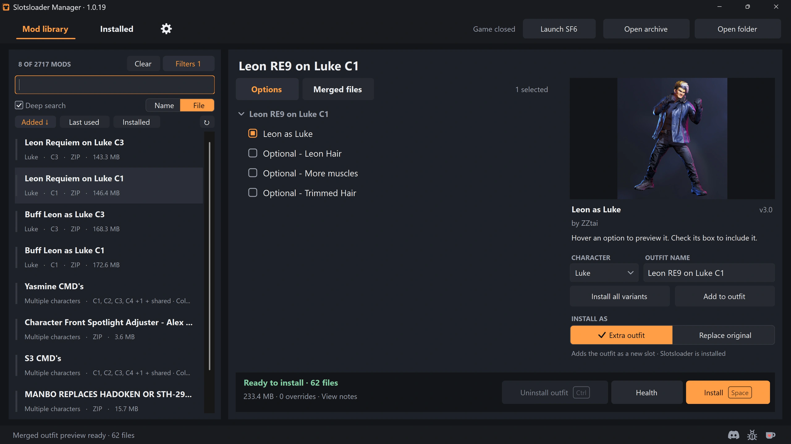

> Not affiliated with or endorsed by Capcom or any other publisher. Mods change game files, so keep backups and use them at your own risk.

## What it does

- **Extra outfits.** Add mods as new costume slots next to the originals, up to 100 per fighter, or replace an existing costume. Extra outfits go through the **SF6 Slots Loader** by Wael3rd, which comes with the Manager.
- **Find mods fast.** Search by author, fighter, costume, keyword or format. Deep search also looks at option names and folders.
- **Load order.** Put mods in priority order. The top mod wins any files they share; everything else stays as it is.
- **Outfit recipes.** Mix parts from different mods, like one mod's hair on another outfit, and save the combination so you never pick every option again. <!-- repo readers; not in the Assistant pack -->
- **Mod options.** Turn a mod's variants and layers on and off, or install a few as separate slots.
- **Presets.** Save what's enabled and bring it back later. Anything already installed is skipped.
- **After game updates.** Click **Reapply all** after an SF6 update or a Steam file check, and your managed mods go back in.
- **Undo anything.** Disable a mod without losing it, switch outfit mods off for a while, or restore the original game files.
- **Checks before installing.** Common problems like outdated colour files are fixed for you, and you'll see when two mods touch the same files.
- **Plays well with others.** Keep using your other mod managers for what they do, or bring in their presets.
- **Optional Assistant.** Ask it to find, install or explain mods. It runs on Claude by Anthropic with your own API key, and every change waits for your OK.

 <!-- repo readers; not in the Assistant pack -->

<b>More screenshots</b>
 <!-- repo readers; not in the Assistant pack -->

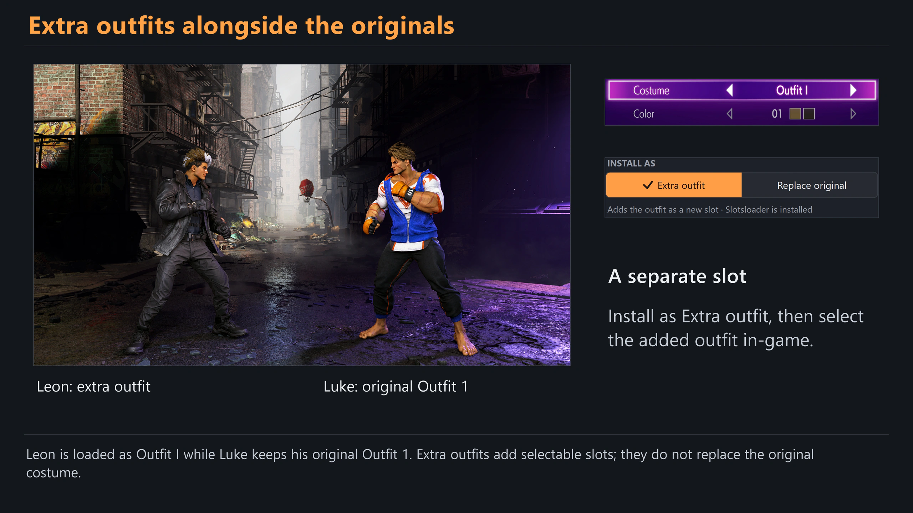

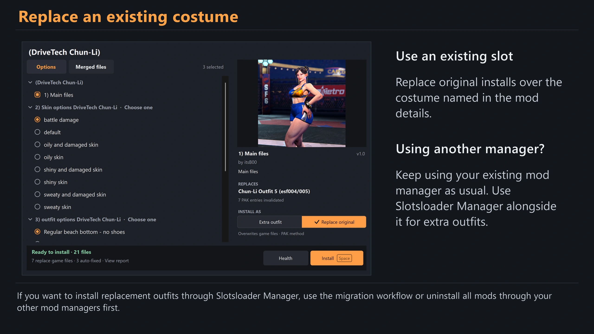

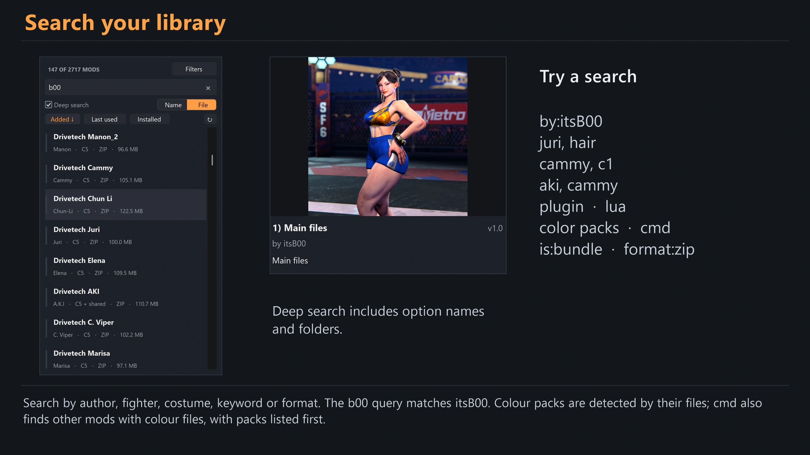

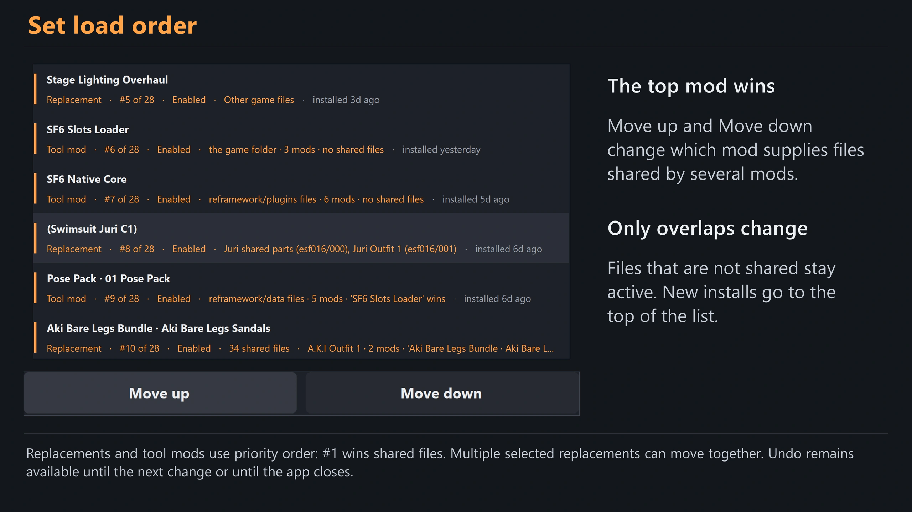

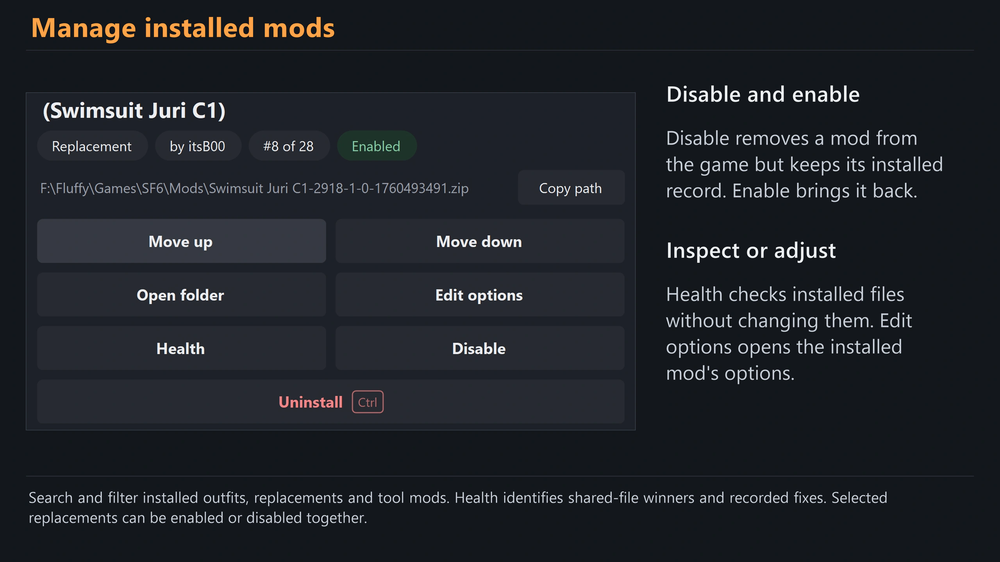

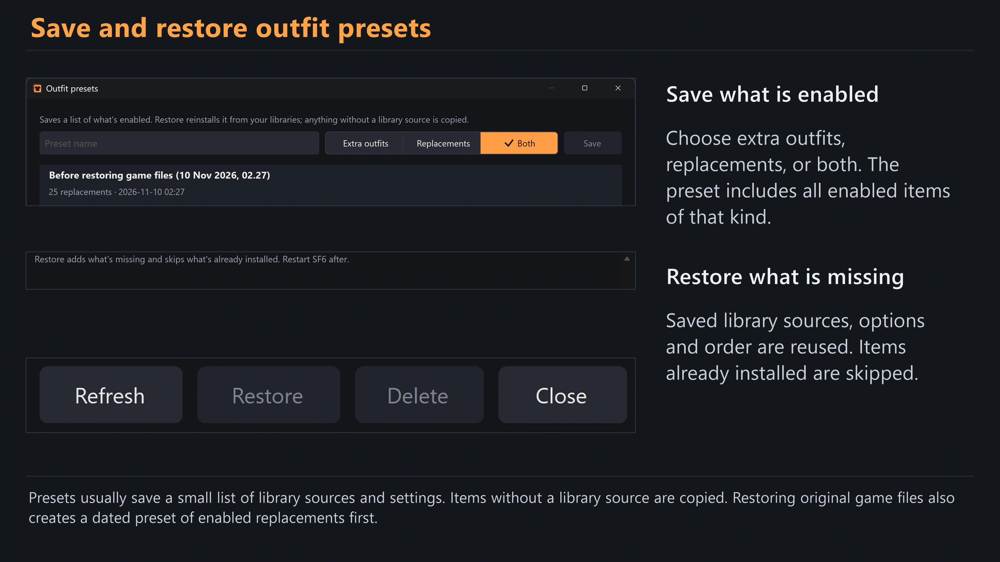

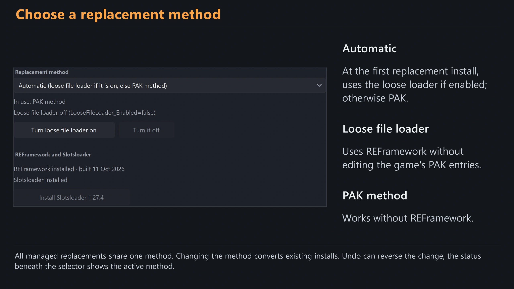

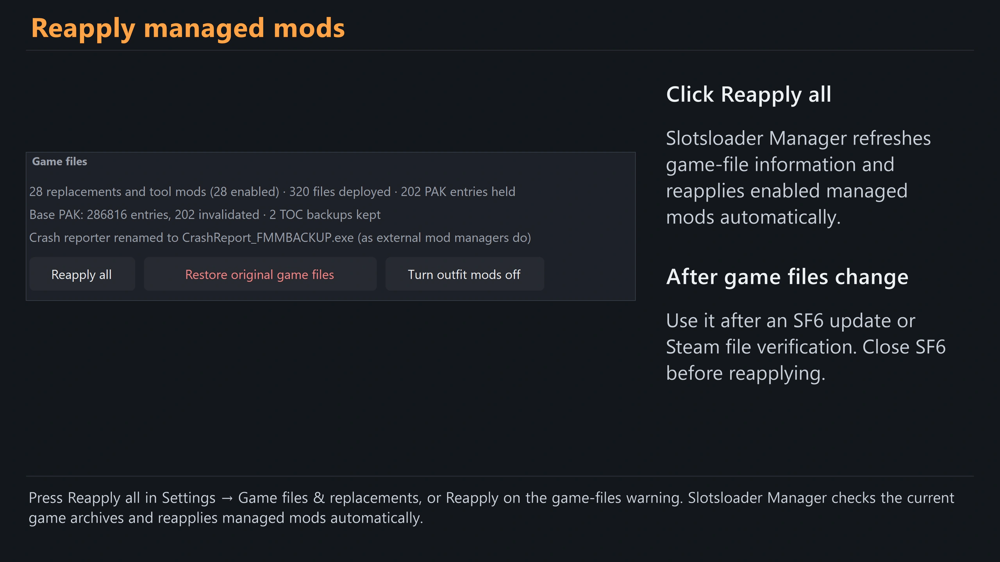

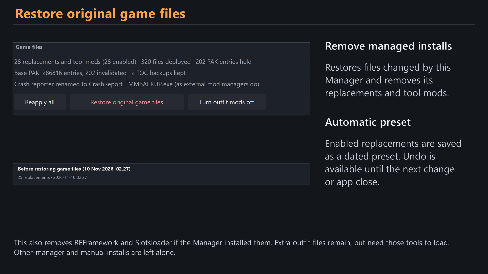

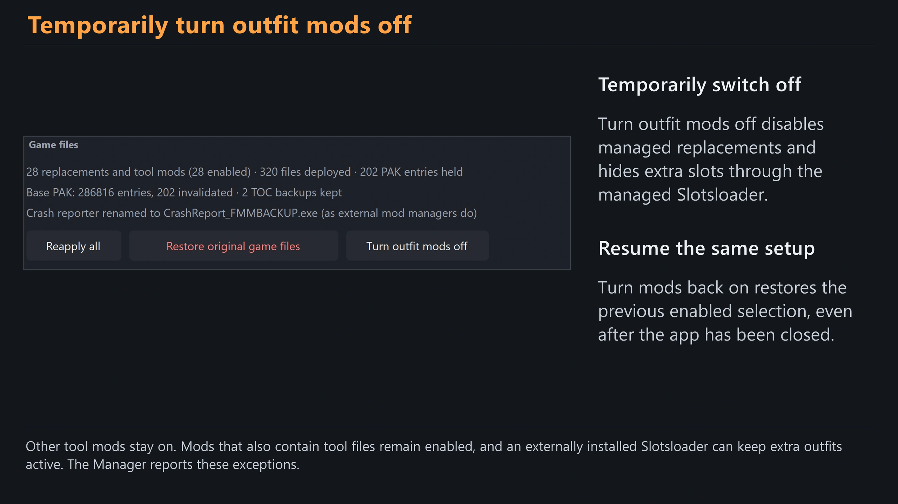

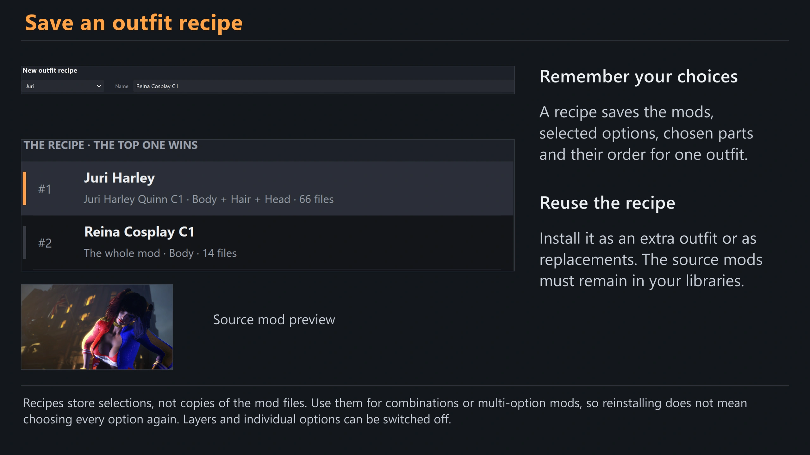

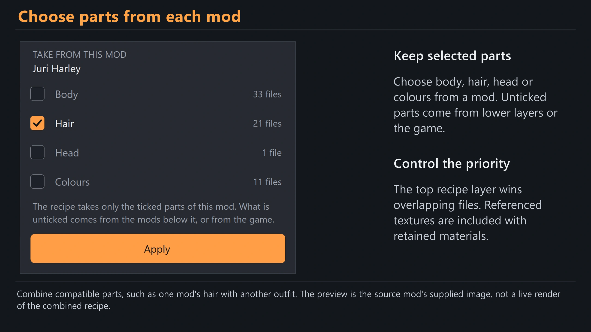

 <!-- repo readers; not in the Assistant pack -->

## Getting started

**You'll need** Street Fighter 6 on Steam and [REFramework](https://github.com/praydog/REFramework) for SF6.

1. Download the Manager from [zztaii.com/modmanager](https://zztaii.com/modmanager) (or [Releases](../../releases/latest)) and unzip it anywhere, like a Games folder.
2. Open **Slotsloader Manager**. It finds SF6 by itself. Add your mod folders in **Settings**.
3. Click **Install Slotsloader** (in **Settings → Slotsloader**). It comes with the Manager.
4. Pick a mod, choose **Extra outfit** or **Replace original**, then **Install**.
5. Click **Launch SF6** and find your new outfits on the character select screen.

Already replacing costumes with another mod manager? Keep it for those, or move them over with the Manager's migration (or uninstall them there) before you replace costumes here.

When there's an update, a small notice shows up in the app. Nothing changes until you click it. Keep the `Data` folder when you update: it holds your settings and the backups of replaced game files.

**Linux and Steam Deck (beta):** download it from [zztaii.com/modmanager](https://zztaii.com/modmanager) or the newest [Linux / Steam Deck beta](../../releases), extract the whole folder and open **Install SlotsLoader Manager.desktop** (on Steam Deck, in Desktop Mode, with Bottles from Discover). The release notes cover the setup. <!-- repo readers; not in the Assistant pack -->

## Good to know about extra outfits

- Mods can be `.zip`, `.rar`, `.7z` or plain folders. 7-Zip is downloaded by itself the first time a `.rar` or `.7z` mod needs it.
- A mod with options becomes one outfit per combination (up to 50 per mod), and you can switch each one on or off. Or pick an outfit's options in the game, if you turn that on in the Manager.
- After a game update the loader rebuilds its data from the game's own files, so new fighters and outfits work without waiting for a loader update.
- Slots made from Outfit 2, 3 or 4 only show up if you own that outfit. Outfit 1 and DriveTech (C5) slots always show.
- Installed through the Manager, the loader never checks for updates from inside the game, and adds to the game's menus only what you tick in the Manager's Slotsloader settings.

## How Slots Loader updates reach you <!-- repo readers; not in the Assistant pack -->

The Manager installs the official Slots Loader zip from Wael3rd's releases, unchanged, and only the version this repo has approved. <!-- repo readers; not in the Assistant pack -->

1. Wael3rd publishes a new SF6 Mod Suite release. <!-- repo readers; not in the Assistant pack -->
2. A daily GitHub Action copies its loader source here and opens a pull request that updates [dependencies.json](dependencies.json): the version, file, size and SHA-256 of each zip. <!-- repo readers; not in the Assistant pack -->
3. Once it's been tested, merging that pull request approves the version. Managers read the list when they start and once a day, offer the update, download it from Wael3rd's release and check every file against the list before installing. <!-- repo readers; not in the Assistant pack -->

The loader source in this repo is that synced copy; see [UPSTREAM.md](UPSTREAM.md). <!-- repo readers; not in the Assistant pack -->

## Building from source <!-- repo readers; not in the Assistant pack -->

- **Slotsloader Manager:** .NET Framework 4.8 (C# 5, no NuGet). Build with `manager\build.ps1` and test with `manager\test.ps1`. `manager\tools\Package-Release.ps1` builds the release zip with the approved loader inside. <!-- repo readers; not in the Assistant pack -->
- **Slots Loader:** Visual Studio 2022 (or Build Tools) with the C++ workload, then `build.bat loader`, `build.bat plugin` or `build.bat sorter`. The full build also needs the shared core (`core\`), which lives in Wael3rd's own source repository of the [SF6 Mod Suite](https://github.com/Wael3rd/SF6-ModSuite) (private); only its headers are synced here. Testing is described in [TESTING.md](TESTING.md). <!-- repo readers; not in the Assistant pack -->

## Community <!-- repo readers; not in the Assistant pack -->

- **Discord:** [discord.gg/9Vr2SJ3](https://discord.gg/9Vr2SJ3). Talk modding, get help, and report bugs. <!-- repo readers; not in the Assistant pack -->
- **Mods and tools:** [zztaii.com](https://zztaii.com/) for ZZtaii's mods, [ColorSync](https://colorsync-sf6.pages.dev/) to colour costumes in your browser, and the published mods on [Nexus Mods](https://www.nexusmods.com/profile/ZZtaii). <!-- repo readers; not in the Assistant pack -->
- **Like it?** [Buy me a coffee](https://www.patreon.com/ZZtai/posts/buy-me-coffee-167011360), or follow [Patreon](https://www.patreon.com/cw/ZZtai) for polls and WIPs. <!-- repo readers; not in the Assistant pack -->

## Credits <!-- repo readers; not in the Assistant pack -->

- **[ZZtaii](https://github.com/ZZtaii)**: Slotsloader Manager, and fixes and Manager mode in the SF6 Slots Loader. <!-- repo readers; not in the Assistant pack -->
- **[Wael3rd](https://github.com/Wael3rd/)**: creator of the [SF6 Slots Loader](https://github.com/Wael3rd/SF6-ModSuite) and the SF6 Mod Suite. <!-- repo readers; not in the Assistant pack -->
- Third-party code and its licenses: [THIRD_PARTY.md](THIRD_PARTY.md) (loader) and [manager/THIRD_PARTY_NOTICES.md](manager/THIRD_PARTY_NOTICES.md) (Manager). <!-- repo readers; not in the Assistant pack -->

## License <!-- repo readers; not in the Assistant pack -->

- **Slots Loader source** (everything except `manager/`): MIT, like Wael3rd's original. See [LICENSE](LICENSE). <!-- repo readers; not in the Assistant pack -->
- **Slotsloader Manager** (`manager/`): source-available for personal, non-commercial use. You're welcome to read it, run it, tweak it for your own modding and share what you make with it. Linking to [zztaii.com/modmanager](https://zztaii.com/modmanager) or the releases page is always welcome; to re-upload the app, include it in a pack or sell it, please ask first. See [manager/LICENSE](manager/LICENSE). <!-- repo readers; not in the Assistant pack -->
