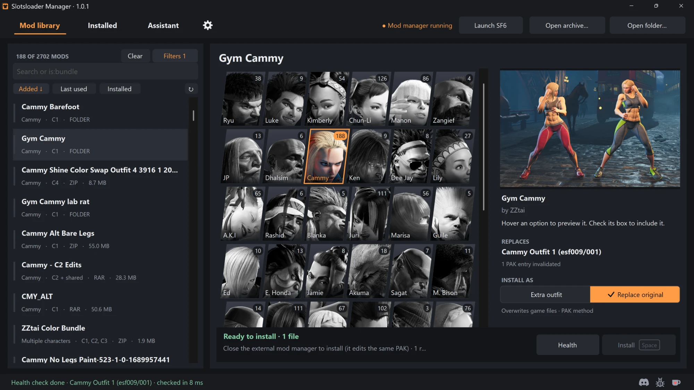

# Slotsloader Manager

A Windows mod manager with faster search, more utility and safer installs. Currently optimized for Street Fighter 6.

This repo also includes **Slotsloader**, the SF6 loader that allows mods to be installed on extra costume slots

> Not affiliated with or endorsed by Capcom or any other publisher. Mods change game files, so keep backups and use them at your own risk.

## What the Manager does

- **Installs mods two ways.** Add a mod as an extra outfit through Slotsloader, or replace the original files, through REFramework's loose file loader or the PAK method. Either way, uninstalling puts the game back exactly as it was.
- **Checks before it installs.** Common problems like outdated colour files, old texture versions and select-screen swatches get fixed automatically. If another mod touches the same files, you'll see it.
- **Lets you undo things.** Uninstalled mods are kept so you can bring them back, and presets save your whole setup.
- **Makes your library easy to search.** Look up mods by character and costume (`cammy, c1`), author (`by:name`) or type (`is:bundle`, `reframework`), filter by fighter, and sort by when a mod was added, installed or last played.
- **Handles mod variants.** Install a few variants of one mod as separate slots, or switch the variants of a bundle on and off.
- **Gets along with other mod managers.** Use it next to them, or import their presets.
- **Has an optional Assistant.** Ask it to find, install or explain mods. It runs on Claude by Anthropic with your own API key, and every change waits for your OK.
- **Has a command line tool.** `Slotsloader CLI.exe` checks mods and manages installs without opening the app.

## What Slotsloader does (SF6)

- Up to 100 extra outfits per fighter, straight from `.zip`, `.rar`, `.7z` or plain folders.
- Mods with options become one outfit per combination (up to 50 per mod), and you can switch each one on or off.
- After a game update it rebuilds its data from the game's own files, so new fighters and outfits work without waiting for a loader update.
- Slots made from Outfit 2, 3 or 4 only show up if you own that outfit. Outfit 1 and DriveTech (C5) slots always show.

## Getting started with SF6

**You'll need** Windows 10 or 11 (64-bit), Street Fighter 6 on Steam, and [REFramework](https://github.com/praydog/REFramework) for SF6. 7-Zip is optional, for `.rar` and `.7z` mods.

1. Grab `Slotsloader-Manager-<version>-portable.zip` from [Releases](../../releases) and extract it anywhere, like `C:\Games\Slotsloader Manager`.
2. Open **Slotsloader Manager.exe**. It finds SF6 through Steam. Add your mod folders in **Settings**.
3. Click **Install Slotsloader**. It comes bundled with the Manager, so no download needed.
4. Pick a mod, choose **Extra outfit** or **Replace original**, and hit **Install**.
5. Click **Launch SF6** and check out your new slots on the character select screen.

When there's an update, a small notice shows up in the app. Nothing installs until you click it.

**Prefer not to use the Manager?** Install the loader zip from [Releases](../../releases) as a tool mod with your mod manager, then drop costume mods into `reframework\costume_mods\<Character>\`. The next time the game starts, it builds the outfit PAK.

## Building from source

- **Slotsloader:** Visual Studio 2022 (or Build Tools) with the C++ workload, then run `build.bat`. There's also a Linux cross-build with llvm-mingw in [docs/BUILD-CUSTOM.md](docs/BUILD-CUSTOM.md). Tests are in [tests/README.md](tests/README.md).
- **Slotsloader Manager:** .NET Framework 4.8 (C# 5, no NuGet). Build with `manager\build.ps1` and test with `manager\test.ps1`. `manager\tools\Package-Release.ps1` builds the release zip with the newest published loader inside.

## Community

- **Discord:** [discord.gg/9Vr2SJ3](https://discord.gg/9Vr2SJ3). Talk modding, get help, and report bugs.
- **Nexus Mods:** [my published mods](https://www.nexusmods.com/profile/ZZtaii).
- **ColorSync:** [color costumes right in your browser](https://colorsync-sf6.pages.dev/).
- **Like it?** [Buy me a coffee](https://www.patreon.com/ZZtai/posts/buy-me-coffee-167011360), or follow [Patreon](https://www.patreon.com/cw/ZZtai) for polls and WIPs.

## Credits

- **[ZZtaii](https://github.com/ZZtaii)**: Slotsloader Manager and maintainer of this Slotsloader fork.
- **[Wael3rd](https://github.com/Wael3rd/)**: creator of the original [SF6 Slots Loader](https://github.com/Wael3rd/SF6-SlotsLoader), the backend Slotsloader builds on.
- Third-party code and its licenses: [THIRD_PARTY.md](THIRD_PARTY.md) (loader) and [manager/THIRD_PARTY_NOTICES.md](manager/THIRD_PARTY_NOTICES.md) (Manager).

## License

- **Slotsloader** (everything except `manager/`): MIT, like Wael3rd's original. See [LICENSE](LICENSE).
- **Slotsloader Manager** (`manager/`): source-available for personal, non-commercial use. You're welcome to read it, run it, tweak it for your own modding and share what you make with it. Redistributing or selling the app itself needs permission. See [manager/LICENSE](manager/LICENSE).
