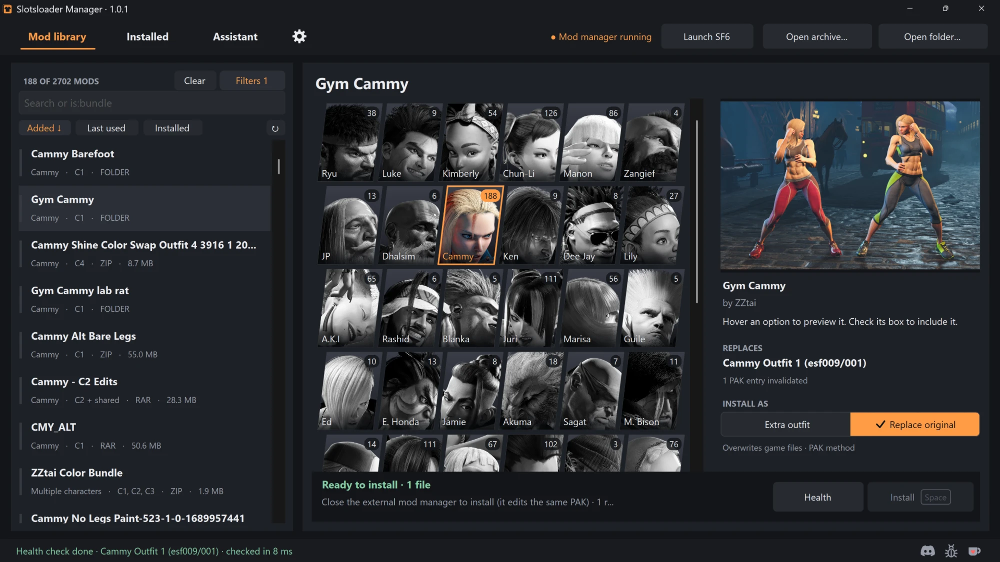

# Slotsloader Manager

A mod manager for Street Fighter 6 with faster search, more utility and safer installs. Windows, with a beta for Linux and Steam Deck.

It installs mods as extra outfits through the **SF6 Slots Loader** by Wael3rd, or in place of the game's originals.

> Not affiliated with or endorsed by Capcom or any other publisher. Mods change game files, so keep backups and use them at your own risk.

## What the Manager does

- **Installs mods two ways.** Add a mod as an extra outfit through the Slots Loader, or replace the original files through REFramework's loose file loader or the PAK method. Uninstalling puts the game back exactly as it was.
- **Mixes parts from several mods.** Add to outfit puts a hair or an add-on from one mod on an outfit you already have; a recipe remembers the result so you can build it again. <!-- repo readers; not in the Assistant pack -->
- **Checks before it installs.** Common problems like outdated colour files, old texture versions and select-screen swatches get fixed automatically. If another mod touches the same files, you'll see it.
- **Lets you undo things.** Uninstalled mods are kept so you can bring them back, and presets save your whole setup.
- **Makes your library easy to search.** Look up mods by character and costume (`cammy, c1`), author (`by:name`) or type (`is:bundle`, `reframework`), filter by fighter, and sort by when a mod was added, installed or last played.
- **Handles mod variants.** Install a few variants of one mod as separate slots, or switch the variants of a bundle on and off.
- **Keeps your outfits in order.** Drag a fighter's outfits into the order you want, or turn every outfit mod off for a while to play vanilla. <!-- repo readers; not in the Assistant pack -->
- **Gets along with other mod managers.** Use it next to them, or import their presets.
- **Has an optional Assistant.** Ask it to find, install or explain mods. It runs on Claude by Anthropic with your own API key, and every change waits for your OK.

## Extra outfits in SF6

- Up to 100 extra outfits per fighter, straight from `.zip`, `.rar`, `.7z` or plain folders.
- Mods with options become one outfit per combination (up to 50 per mod), and you can switch each one on or off. Or pick an outfit's options in the game, if you turn that on in the Manager.
- After a game update the loader rebuilds its data from the game's own files, so new fighters and outfits work without waiting for a loader update.
- Slots made from Outfit 2, 3 or 4 only show up if you own that outfit. Outfit 1 and DriveTech (C5) slots always show.
- Installed through the Manager, it never checks for updates from inside the game, and adds to the game's menus only what you tick in the Manager's Slotsloader settings.

## Getting started

**You'll need** Windows 10 or 11 (64-bit), Street Fighter 6 on Steam, and [REFramework](https://github.com/praydog/REFramework) for SF6. 7-Zip is optional, for `.rar` and `.7z` mods.

1. Grab `Slotsloader-Manager-<version>-portable.zip` from [Releases](../../releases/latest) and extract it anywhere, like `C:\Games\Slotsloader Manager`.
2. Open **Slotsloader Manager.exe**. It finds SF6 through Steam. Add your mod folders in **Settings**.
3. In **Settings → Slotsloader**, click **Install Slotsloader**. It comes bundled with the Manager, so no download needed.
4. Pick a mod, choose **Extra outfit** or **Replace original**, and hit **Install**.
5. Click **Launch SF6** and check out your new slots on the character select screen.

When there's an update, a small notice shows up in the app. Nothing installs until you click it. Keep the `Data` folder when you update: it holds your settings and the backups of replaced game files.

**Linux and Steam Deck:** get the `linux` ZIP of the newest [Linux / Steam Deck beta](../../releases), extract the whole folder and open **Install SlotsLoader Manager.desktop** (on Steam Deck, in Desktop Mode, with Bottles from Discover). The release notes cover the setup. <!-- repo readers; not in the Assistant pack -->

## How Slots Loader updates reach you <!-- repo readers; not in the Assistant pack -->

The Manager installs the official Slots Loader zip from Wael3rd's releases, unchanged, and only the version this repo has approved. <!-- repo readers; not in the Assistant pack -->

1. Wael3rd publishes a new SF6 Mod Suite release. <!-- repo readers; not in the Assistant pack -->
2. A daily GitHub Action copies its loader source here and opens a pull request that updates [dependencies.json](dependencies.json): the version, file, size and SHA-256 of each zip. <!-- repo readers; not in the Assistant pack -->
3. Once it's been tested, merging that pull request approves the version. Managers read the list when they start and once a day, offer the update, download it from Wael3rd's release and check every file against the list before installing. <!-- repo readers; not in the Assistant pack -->

The loader source in this repo is that synced copy; see [UPSTREAM.md](UPSTREAM.md). <!-- repo readers; not in the Assistant pack -->

## Building from source <!-- repo readers; not in the Assistant pack -->

- **Slotsloader Manager:** .NET Framework 4.8 (C# 5, no NuGet). Build with `manager\build.ps1` and test with `manager\test.ps1`. `manager\tools\Package-Release.ps1` builds the release zip with the approved loader inside. <!-- repo readers; not in the Assistant pack -->
- **Slots Loader:** Visual Studio 2022 (or Build Tools) with the C++ workload, then `build.bat loader`, `build.bat plugin` or `build.bat sorter`. The full build also needs the shared core (`core\`), which lives in Wael3rd's own source repository of the [SF6 Mod Suite](https://github.com/Wael3rd/SF6-ModSuite) (private); only its headers are synced here. Testing is described in [TESTING.md](TESTING.md). <!-- repo readers; not in the Assistant pack -->

## Community <!-- repo readers; not in the Assistant pack -->

- **Discord:** [discord.gg/9Vr2SJ3](https://discord.gg/9Vr2SJ3). Talk modding, get help, and report bugs. <!-- repo readers; not in the Assistant pack -->
- **Mods and tools:** [zztaii.com](https://zztaii.com/) for ZZtaii's mods, [ColorSync](https://colorsync-sf6.pages.dev/) to colour costumes in your browser, and the published mods on [Nexus Mods](https://www.nexusmods.com/profile/ZZtaii). <!-- repo readers; not in the Assistant pack -->
- **Like it?** [Buy me a coffee](https://www.patreon.com/ZZtai/posts/buy-me-coffee-167011360), or follow [Patreon](https://www.patreon.com/cw/ZZtai) for polls and WIPs. <!-- repo readers; not in the Assistant pack -->

## Credits <!-- repo readers; not in the Assistant pack -->

- **[ZZtaii](https://github.com/ZZtaii)**: Slotsloader Manager, and fixes and Manager mode in the SF6 Slots Loader. <!-- repo readers; not in the Assistant pack -->
- **[Wael3rd](https://github.com/Wael3rd/)**: creator of the [SF6 Slots Loader](https://github.com/Wael3rd/SF6-ModSuite) and the SF6 Mod Suite. <!-- repo readers; not in the Assistant pack -->
- Third-party code and its licenses: [THIRD_PARTY.md](THIRD_PARTY.md) (loader) and [manager/THIRD_PARTY_NOTICES.md](manager/THIRD_PARTY_NOTICES.md) (Manager). <!-- repo readers; not in the Assistant pack -->

## License <!-- repo readers; not in the Assistant pack -->

- **Slots Loader source** (everything except `manager/`): MIT, like Wael3rd's original. See [LICENSE](LICENSE). <!-- repo readers; not in the Assistant pack -->
- **Slotsloader Manager** (`manager/`): source-available for personal, non-commercial use. You're welcome to read it, run it, tweak it for your own modding and share what you make with it. Redistributing the app itself (re-uploading it, its zips or its source to other sites, mod pages or repositories, or bundling it) or selling it needs permission beforehand; linking to the releases page is always fine. See [manager/LICENSE](manager/LICENSE). <!-- repo readers; not in the Assistant pack -->
